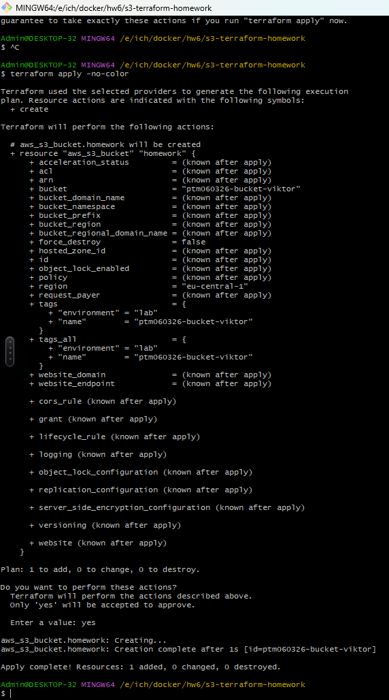
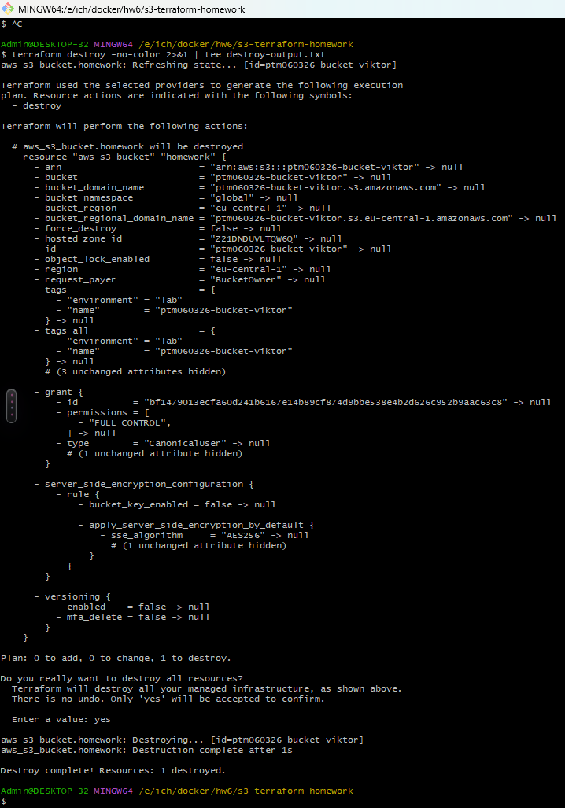

# Создание S3-бакета с помощью Terraform: команды и результаты

Имя: Viktor. Группа: PTM060326.
Терминал: Git Bash. Регион AWS: eu-central-1 (Frankfurt).

Ниже приведены выполненные команды и результаты их работы. Все шаги выполнялись в Git Bash. Бакет создан и затем удалён.

## 1. Переход в папку и просмотр файлов

Команды:

```bash
cd /e/ich/docker/hw6/s3-terraform-homework
ls -la
```

Команда cd при успешном выполнении ничего не выводит. Результат ls -la на момент запуска:

```text
total 77
drwxr-xr-x 1 Admin 197121     0 Oct 18 18:59 ./
drwxr-xr-x 1 Admin 197121     0 Oct 18 18:54 ../
-rw-r--r-- 1 Admin 197121   646 Oct 18 19:08 .gitignore
drwxr-xr-x 1 Admin 197121     0 Oct 18 18:54 .terraform/
-rw-r--r-- 1 Admin 197121  1452 Oct 18 18:54 .terraform.lock.hcl
-rw-r--r-- 1 Admin 197121  2835 Oct 18 19:00 README.md
-rw-r--r-- 1 Admin 197121 40559 Oct 18 18:58 apply-output.png
-rw-r--r-- 1 Admin 197121   181 Oct 18 18:55 apply-output.txt
-rw-r--r-- 1 Admin 197121  2539 Oct 18 18:56 destroy-output.txt
-rw-r--r-- 1 Admin 197121  3220 Oct 18 18:55 homework.tfplan
-rw-r--r-- 1 Admin 197121   141 Oct 18 18:46 main.tf
-rw-r--r-- 1 Admin 197121   136 Oct 18 18:46 providers.tf
-rw-r--r-- 1 Admin 197121   181 Oct 18 18:56 terraform.tfstate
-rw-r--r-- 1 Admin 197121  3141 Oct 18 18:56 terraform.tfstate.backup
-rw-r--r-- 1 Admin 197121   158 Oct 18 18:46 variables.tf
```

## 2. Инициализация Terraform

Команда подготавливает рабочую папку и AWS-провайдер. Ресурсы в AWS не создаёт.

```bash
terraform init
```

Вывод:

```text
Initializing the backend...

Initializing provider plugins...
- Reusing previous version of hashicorp/aws from the dependency lock file
- Using previously-installed hashicorp/aws v6.69.1

Terraform has been successfully initialized!

You may now begin working with Terraform. Try running "terraform plan" to see
any changes that are required for your infrastructure. All Terraform commands
should now work.

If you ever set or change modules or backend configuration for Terraform,
rerun this command to reinitialize your working directory. If you forget, other
commands will detect it and remind you to do so if necessary.
```

## 3. Проверка конфигурации

Команда проверяет корректность конфигурации без создания ресурсов.

```bash
terraform validate
```

Вывод:

```text
Success! The configuration is valid.
```

## 4. Планирование

Команда показывает предполагаемые изменения. Знак + означает создание ресурса.

```bash
terraform plan
```

Вывод:

```text
Terraform used the selected providers to generate the following execution
plan. Resource actions are indicated with the following symbols:
  + create

Terraform will perform the following actions:

  # aws_s3_bucket.homework will be created
  + resource "aws_s3_bucket" "homework" {
      + acceleration_status         = (known after apply)
      + acl                         = (known after apply)
      + arn                         = (known after apply)
      + bucket                      = "ptm060326-bucket-viktor"
      + bucket_domain_name          = (known after apply)
      + bucket_namespace            = (known after apply)
      + bucket_prefix               = (known after apply)
      + bucket_region               = (known after apply)
      + bucket_regional_domain_name = (known after apply)
      + force_destroy               = false
      + hosted_zone_id              = (known after apply)
      + id                          = (known after apply)
      + object_lock_enabled         = (known after apply)
      + policy                      = (known after apply)
      + region                      = "eu-central-1"
      + request_payer               = (known after apply)
      + tags                        = {
          + "environment" = "lab"
          + "name"        = "ptm060326-bucket-viktor"
        }
      + tags_all                    = {
          + "environment" = "lab"
          + "name"        = "ptm060326-bucket-viktor"
        }
      + website_domain              = (known after apply)
      + website_endpoint            = (known after apply)

      + cors_rule (known after apply)

      + grant (known after apply)

      + lifecycle_rule (known after apply)

      + logging (known after apply)

      + object_lock_configuration (known after apply)

      + replication_configuration (known after apply)

      + server_side_encryption_configuration (known after apply)

      + versioning (known after apply)

      + website (known after apply)
    }

Plan: 1 to add, 0 to change, 0 to destroy.

─────────────────────────────────────────────────────────────────────────────

Note: You didn't use the -out option to save this plan, so Terraform can't
guarantee to take exactly these actions if you run "terraform apply" now.
```

## 5. Создание бакета

Команда повторно строит план и после подтверждения yes создаёт бакет.

```bash
terraform apply -no-color
```

Вывод, включая введённое подтверждение:

```text
Terraform used the selected providers to generate the following execution
plan. Resource actions are indicated with the following symbols:
  + create

Terraform will perform the following actions:

  # aws_s3_bucket.homework will be created
  + resource "aws_s3_bucket" "homework" {
      + acceleration_status         = (known after apply)
      + acl                         = (known after apply)
      + arn                         = (known after apply)
      + bucket                      = "ptm060326-bucket-viktor"
      + bucket_domain_name          = (known after apply)
      + bucket_namespace            = (known after apply)
      + bucket_prefix               = (known after apply)
      + bucket_region               = (known after apply)
      + bucket_regional_domain_name = (known after apply)
      + force_destroy               = false
      + hosted_zone_id              = (known after apply)
      + id                          = (known after apply)
      + object_lock_enabled         = (known after apply)
      + policy                      = (known after apply)
      + region                      = "eu-central-1"
      + request_payer               = (known after apply)
      + tags                        = {
          + "environment" = "lab"
          + "name"        = "ptm060326-bucket-viktor"
        }
      + tags_all                    = {
          + "environment" = "lab"
          + "name"        = "ptm060326-bucket-viktor"
        }
      + website_domain              = (known after apply)
      + website_endpoint            = (known after apply)

      + cors_rule (known after apply)

      + grant (known after apply)

      + lifecycle_rule (known after apply)

      + logging (known after apply)

      + object_lock_configuration (known after apply)

      + replication_configuration (known after apply)

      + server_side_encryption_configuration (known after apply)

      + versioning (known after apply)

      + website (known after apply)
    }

Plan: 1 to add, 0 to change, 0 to destroy.

Do you want to perform these actions?
  Terraform will perform the actions described above.
  Only 'yes' will be accepted to approve.

  Enter a value: yes

aws_s3_bucket.homework: Creating...
aws_s3_bucket.homework: Creation complete after 1s [id=ptm060326-bucket-viktor]

Apply complete! Resources: 1 added, 0 changed, 0 destroyed.
```

Бакет ptm060326-bucket-viktor создан в регионе eu-central-1. Теги: name = ptm060326-bucket-viktor и environment = lab.

Скриншот непосредственного выполнения команды:



## 6. Удаление бакета и сохранение вывода

Выполнена команда в Git Bash:

```bash
terraform destroy -no-color 2>&1 | tee destroy-output.txt
```

При запросе подтверждения нужно ввести yes. Команда tee одновременно показывает вывод в терминале и сохраняет его в destroy-output.txt. Перенаправление 2>&1 включает сообщения об ошибках. Параметр -no-color убирает цветовые коды.

Фактический вывод из destroy-output.txt (введённое yes видно на скриншоте; tee не записал ввод с клавиатуры):

```text
aws_s3_bucket.homework: Refreshing state... [id=ptm060326-bucket-viktor]

Terraform used the selected providers to generate the following execution
plan. Resource actions are indicated with the following symbols:
  - destroy

Terraform will perform the following actions:

  # aws_s3_bucket.homework will be destroyed
  - resource "aws_s3_bucket" "homework" {
      - arn                         = "arn:aws:s3:::ptm060326-bucket-viktor" -> null
      - bucket                      = "ptm060326-bucket-viktor" -> null
      - bucket_domain_name          = "ptm060326-bucket-viktor.s3.amazonaws.com" -> null
      - bucket_namespace            = "global" -> null
      - bucket_region               = "eu-central-1" -> null
      - bucket_regional_domain_name = "ptm060326-bucket-viktor.s3.eu-central-1.amazonaws.com" -> null
      - force_destroy               = false -> null
      - hosted_zone_id              = "Z21DNDUVLTQW6Q" -> null
      - id                          = "ptm060326-bucket-viktor" -> null
      - object_lock_enabled         = false -> null
      - region                      = "eu-central-1" -> null
      - request_payer               = "BucketOwner" -> null
      - tags                        = {
          - "environment" = "lab"
          - "name"        = "ptm060326-bucket-viktor"
        } -> null
      - tags_all                    = {
          - "environment" = "lab"
          - "name"        = "ptm060326-bucket-viktor"
        } -> null
        # (3 unchanged attributes hidden)

      - grant {
          - id          = "bf1479013ecfa60d241b6167e14b89cf874d9bbe538e4b2d626c952b9aac63c8" -> null
          - permissions = [
              - "FULL_CONTROL",
            ] -> null
          - type        = "CanonicalUser" -> null
            # (1 unchanged attribute hidden)
        }

      - server_side_encryption_configuration {
          - rule {
              - bucket_key_enabled = false -> null

              - apply_server_side_encryption_by_default {
                  - sse_algorithm     = "AES256" -> null
                    # (1 unchanged attribute hidden)
                }
            }
        }

      - versioning {
          - enabled    = false -> null
          - mfa_delete = false -> null
        }
    }

Plan: 0 to add, 0 to change, 1 to destroy.

Do you really want to destroy all resources?
  Terraform will destroy all your managed infrastructure, as shown above.
  There is no undo. Only 'yes' will be accepted to confirm.

  Enter a value: 
aws_s3_bucket.homework: Destroying... [id=ptm060326-bucket-viktor]
aws_s3_bucket.homework: Destruction complete after 1s

Destroy complete! Resources: 1 destroyed.
```



Результат: Terraform подтвердил удаление одного ресурса — S3-бакета ptm060326-bucket-viktor.
